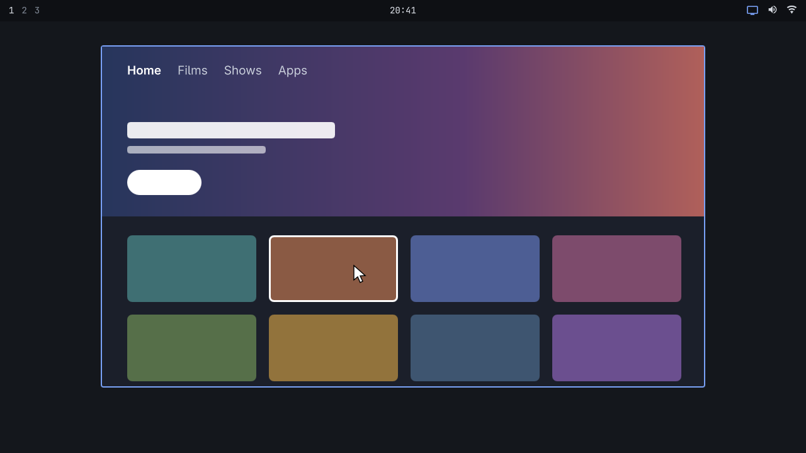

# omarchyTVview

**Watch and control your Android TV in a window on your Omarchy desktop.**

Click the icon in the bar and your TV's screen opens in a window, with its sound. Your mouse and
keyboard drive the TV while the pointer is over the window. Click the icon again to close it.



omarchyTVview is an Omarchy shell plugin built on [scrcpy](https://github.com/Genymobile/scrcpy). It
works with Android TV and Google TV devices. It's an independent project, not part of OmarchyTV, and
you don't need OmarchyTV to use it. If you do have OmarchyTV paired, omarchyTVview finds your TV from
that pairing.

## What you need

- **Omarchy 4.**
- **`scrcpy` and `adb`.** Installing `scrcpy` brings in `adb` too. The install steps below cover this.
- **An Android TV or Google TV device** on the same network as this computer, with network debugging
  turned on. Sound needs Android 11 or newer.
- `jq`, which Omarchy already includes, to read the OmarchyTV pairing.
- `notify-send`, which Omarchy also includes, for the message you see when something fails.

## Install

**1. Install scrcpy.**

```bash
sudo pacman -S scrcpy
```

**2. Turn on network debugging on the TV.** Menu names vary a little between TVs.

1. Open **Settings → System → About**, and select **Android TV OS build** seven times. This unlocks
   the developer options.
2. Go back to **Settings → System → Developer options**, and turn on **Network debugging**.

**3. Install the plugin.**

```bash
omarchy plugin add https://github.com/28allday/omarchyTVview
```

Choose where the icon goes when asked. A TV icon appears in the bar.

**4. Tell it where your TV is.** If you've paired the TV with the OmarchyTV PC plugin, skip this step.
Otherwise find the TV's address under **Settings → Network & Internet**, then save it:

```bash
mkdir -p ~/.config/omarchytvview
echo 192.168.1.50 > ~/.config/omarchytvview/address
```

Use your TV's address in place of `192.168.1.50`. If you have this file, it's used instead of the
pairing. Add `:port` to the address if your TV doesn't use the usual port 5555. Give the TV a fixed
address in your router so this doesn't go out of date.

**5. Allow this computer on the TV.** Click the icon in the bar. The first time you connect, the TV asks
whether to allow debugging from this computer. Choose **Always allow**, then click the icon again.

## Using it

Click the icon to open the window, and click it again to close it. You can also close the window
itself. The icon takes your theme's accent colour while the window is open.

| On this computer | On the TV |
| --- | --- |
| Left click | Select |
| Right click | Back |
| Middle click | Home |
| Arrow keys and Enter | The remote's direction and OK buttons |
| Typing | Text entry |
| `Alt+F` or `F11` | Makes the window fullscreen (doesn't change the TV) |

Some TV apps only respond to the remote's direction buttons, so use the arrow keys and Enter for those.

The sound depends on the TV's Android version:

- **Android 13 or newer:** it plays on both the TV and this computer.
- **Android 12:** it moves to this computer.
- **Android 11:** it also moves here, but the TV must be unlocked when you open the window.
- **Older than Android 11:** there's no sound in the window.

On Android 13 or newer, an app can refuse to share its sound, so you may only hear it on the TV.

Apps that protect their video, such as Netflix or Disney+, usually show a black picture in the window.
They carry on playing normally on the TV.

## From a keybinding or script

```bash
omarchy-shell omarchytvview toggle
omarchy-shell omarchytvview start
omarchy-shell omarchytvview stop
omarchy-shell omarchytvview status
```

`status` answers `running`, `stopped` or `error`.

## Privacy and security

- The picture and sound travel directly between the TV and this computer. omarchyTVview doesn't send
  anything anywhere else, and it has no account or analytics.
- **Network debugging gives full control of the TV to any computer you've allowed.** Other devices on
  your network can reach the port and ask, which puts a prompt on the TV, so only accept prompts you
  expect. Turn it off if you stop using this, and don't use it on a network you don't trust.
- With network debugging, the connection isn't encrypted. Someone able to watch your network traffic
  could see what's on the TV.
- If you use the OmarchyTV pairing, omarchyTVview reads only the TV's address from it, never its token.
- The plugin doesn't change your Omarchy settings. The address file is the only file of its own, and
  you create that yourself. `adb` keeps its key in `~/.android`, and scrcpy copies a small temporary
  program to the TV while the window is open.
- Opening the window starts `adb`'s background server, which keeps running after you close it. To stop
  it, run `adb kill-server`.

## Troubleshooting

When something goes wrong you get a desktop notification, and the same message shows when you hover
over the icon.

| Message | What to do |
| --- | --- |
| **Can't reach the TV at …** | Check the TV is on and network debugging is on. Check the address too, since it may have changed. |
| **The TV hasn't allowed this PC yet** | Accept the prompt on the TV, then click the icon again. If there's no prompt, run `adb kill-server` and try again. |
| **No TV found** | Follow step 4 of the install. |
| **That TV address doesn't look right** | Open `~/.config/omarchytvview/address`. It should hold just the address, such as `192.168.1.50`. |
| **adb is not installed** or **scrcpy is not installed** | Run `sudo pacman -S scrcpy`. |
| **The connection to the TV ended** | The TV went to sleep or dropped off the network. Wake it and click the icon again. |

If your TV only offers **Wireless debugging**, it uses a pairing code and a port that can change. Pair
once with `adb pair <address>:<pairing port>`, then put `<address>:<port>` in the address file. You'll
need to update the file if the port changes.

## Updating

```bash
omarchy plugin update nosignal.omarchytvview
```

## Removing it

```bash
omarchy plugin remove nosignal.omarchytvview
rm -rf ~/.config/omarchytvview
adb kill-server
```

Then, on the TV, open **Settings → System → Developer options**, turn off **Network debugging**, and use
**Revoke USB debugging authorizations** to forget this computer. To remove scrcpy as well, run
`sudo pacman -Rns scrcpy`.

## Credits

The window, the picture and the sound are all [scrcpy](https://github.com/Genymobile/scrcpy) by Genymobile
and Romain Vimont. omarchyTVview puts it one click away in your bar.

## License

MIT. See [LICENSE](LICENSE).
